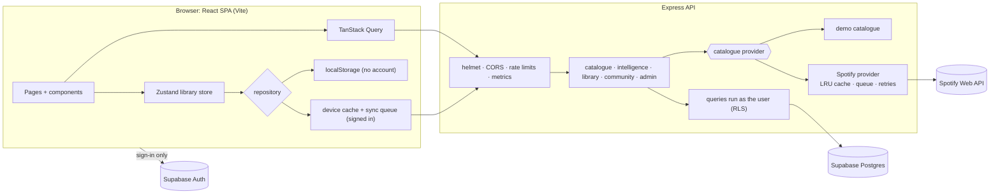
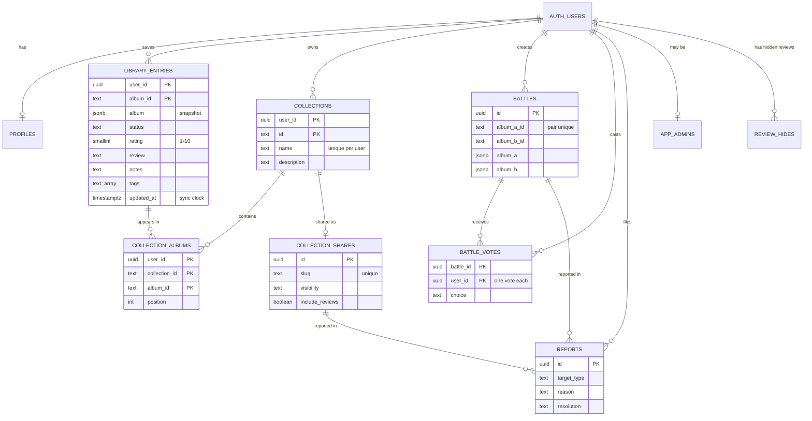

# Albumly

Search any artist and explore everything they have released: albums, singles, EPs, compilations and guest appearances. Inspect albums and tracklists, keep your own library of ratings, notes and collections, get recommendations with a reason for each, and share collections or vote in album battles.

Albumly is an independent project that uses the Spotify Web API. It is **not affiliated with or endorsed by Spotify**. It never plays audio and never asks you to sign in to Spotify.

## Features

**Release 1: explore**
- Artist search with suggestions: debounced, cancellable, and fully keyboard-accessible.
- The complete discography in one view:
  - tabs for albums, singles, inferred EPs, compilations and guest appearances
  - filter, year range and sort
  - grid, list and timeline views
  - every setting kept in the URL
- Deluxe and remastered editions stacked under the original (similarity score + union-find).
- A completeness report: what was loaded per group, duplicates removed, editions detected.
- Album pages: tracks by disc, computed total length, track search, Spotify links, copy and share.

**Release 1.5: your library (no account needed)**
- Statuses, 1–10 ratings, reviews, notes, tags and collections (drag, keyboard or buttons to reorder).
- Library filters, JSON/CSV export, and JSON import with an exact error report. Validated, versioned storage that salvages damaged data.
- Compare two albums side by side (table + chart).
- Smart search that understands queries like `neon harbor 2015 album`.

**Release 2: accounts**
- Optional email accounts (Supabase Auth). Your library syncs across devices, with offline edits queued.
- First sign-in offers to move the browser library into the account.
- Account deletion and a privacy page.

**Intelligence**
- Recommendations computed by Albumly from your library and a short quiz, each with a "why this?" breakdown and adjustable weights.
- Insights about your Albumly library, a Music DNA card, a release calendar, an artist connection map (breadth-first search), and career eras on artist pages.

**Release 3: community and ops**
- Share a collection by link. Logged-out visitors can open it; private notes are never shared.
- Album Battle: one vote per person, enforced by the database, and a leaderboard ranked by the Wilson score.
- Report and moderation tools, plus an admin dashboard (requests, latency, cache, Spotify limits, top searches).

## Architecture



- The browser never talks to Spotify and never sees a secret.
- Library data goes React → Express → Postgres. The browser talks to Supabase directly only to sign in.
- More detail: [docs/architecture.md](docs/architecture.md).

### Data model (with accounts)



- Every table has row-level security.
- Schema: [database/migrations](database/migrations).
- Without an account, the same library shape lives in the browser's localStorage.

## Getting started

Requires **Node.js 20.19+** (developed on 24).

```bash
npm run install:all
```

### Demo mode (recommended first)

```bash
npm run dev:demo
```

- Opens the client on http://localhost:5199 with its own API on port 5055.
- That API always serves a **fictional demo catalogue**: about 20 artists with generated covers and deliberate edge cases.
- No Spotify account and no settings are needed, and nothing counts against Spotify's limits.
- The footer says "Demo mode".
- Try Neon Harbor, Mara Voss, Cass Marlowe (guest appearances) or Driftwood Recordings (compilations), or search `!error` to see the error state.

### Normal development

```bash
npm run dev
```

- The client runs on http://localhost:5173 and the API on http://localhost:5000 (check http://localhost:5000/api/health). The client proxies `/api/*` to the API.
- Copy `server/.env.example` to `server/.env`. With `CATALOG_PROVIDER=mock` this is demo mode too.

### Live Spotify data

1. Create an app in the Spotify Developer Dashboard. The app owner needs **active Spotify Premium**.
2. In `server/.env`, set `SPOTIFY_CLIENT_ID`, `SPOTIFY_CLIENT_SECRET` and `CATALOG_PROVIDER=spotify`.
3. Optional: `npm run spike --prefix server` checks your credentials against each endpoint. It spends real requests, so run it sparingly.

**Spotify's limits.** Spotify gives new apps a small allowance:
- About **100 artist-discography pages a day**. Going over blocks that endpoint for about 24 hours.
- Search and album lookups usually keep working.

Albumly copes in several ways:
- It caches everything (searches 10 min, artists 1 day, discographies and albums 7 days), saved to `server/.cache`.
- Compilations and guest appearances load only when their tab is opened.
- It remembers blocks and never retries a blocked endpoint early.
- Discover's "Look up" button has its own daily cap (`INTELLIGENCE_DAILY_REQUESTS`, default 30).

Details: [docs/phase-2-concepts.md](docs/phase-2-concepts.md).

### Accounts (optional)

Without these settings Albumly runs without accounts and keeps the library in the browser. The Battles, sharing and admin pages then explain that accounts are off.

1. Create a free Supabase project. The step-by-step guide is in [docs/plans/phase-5-plan.md](docs/plans/phase-5-plan.md) §10: project, keys, JWT signing keys, session-pooler connection string, SSL certificate, email settings and redirect URLs.
2. Fill in the settings (names below; never commit the values).
3. `npm run db:migrate --prefix server` creates the tables and policies (`database/migrations/0001`–`0004`).
4. Optional: `npm run live-check --prefix server` runs an end-to-end check with two throwaway accounts, deleted afterwards.

### Making yourself an admin

The admin dashboard (`/admin`) is open to users listed in `public.app_admins`. Sign up in the app first, then run this once in the Supabase SQL editor, with your own address in place of the placeholder:

```sql
insert into public.app_admins (user_id) select id from auth.users where email = '<your email>';
```

## Environment variables

**`server/.env`** (git-ignored; copy from `server/.env.example`):

| Name | Needed for | Secret? | Notes |
| --- | --- | --- | --- |
| `API_PORT` | always | no | Local port, default 5000. In production the host's `PORT` is used |
| `CLIENT_ORIGIN` | always | no | Allowed browser origins (CORS), comma-separated |
| `CATALOG_PROVIDER` | always | no | `mock` (demo) or `spotify` |
| `SPOTIFY_CLIENT_ID`, `SPOTIFY_CLIENT_SECRET` | live data | the secret is | From the Spotify Developer Dashboard |
| `SPOTIFY_MARKET` | optional | no | Two-letter country code; removes regional duplicates |
| `INTELLIGENCE_DAILY_REQUESTS` | optional | no | Daily Spotify requests for Discover lookups (default 30, 0 = off) |
| `SUPABASE_URL`, `SUPABASE_PUBLISHABLE_KEY` | accounts | no | Project URL and publishable key |
| `SUPABASE_SECRET_KEY` | accounts | **yes** | Used only to delete accounts and, with the setting below, to create confirmed accounts |
| `SIGNUP_EMAIL_CONFIRMATION` | accounts | no | `off`: the server creates accounts already confirmed, so sign-up sends no email (Supabase's built-in sender allows only a few per hour). Empty: Supabase's confirmation emails |
| `DATABASE_URL` | accounts | **yes** | Session-pooler connection string |
| `DATABASE_SSL_CA` | accounts | no | Path to the downloaded CA certificate (required in production) |
| `TRUST_PROXY` | hosting | no | Number of proxies in front of the API (usually `1`) |

**`client/.env.local`** (git-ignored; everything here ends up in the browser, so public values only):

| Name | Notes |
| --- | --- |
| `VITE_SUPABASE_URL`, `VITE_SUPABASE_PUBLISHABLE_KEY` | Turn accounts on in the client |
| `VITE_API_BASE_URL` | Production only: the API's address when it is on another host |
| `VITE_SITE_URL` | Production only: the site's address, so share previews get an absolute image link |

## Testing

| Command | What it runs |
| --- | --- |
| `npm test` | Vitest: server (routes, Spotify client against a fake, caching, PGlite database + RLS) and client (logic, stores, components) |
| `npm run lint` | oxlint on the client |
| `npm run test:e2e` | Playwright end-to-end tests in Chromium (below) |
| `npm run test:e2e:report` | Open the last end-to-end HTML report |
| `npm run test:lighthouse` | Lighthouse on the production build; reports in `e2e/lighthouse/` |
| `npm run build` then `npm run check:bundle` | Production build, then the 200 KB gzip budget for the first page load |
| `npm run check:secrets` | Scan the repo for committed secrets (prints file:line and rule, never the value) |
| `npm run check:audit` | `npm audit` for all three packages (read-only) |

**About the Playwright suite.** First-time setup is `npx playwright install chromium --only-shell` (about 110 MB, Chromium only). Playwright starts its own servers and stops them when it is done:

| Port | What |
| --- | --- |
| 5066 | API, demo catalogue, accounts off |
| 5288 | Client (dev server) |
| 5067 | API with accounts, using PGlite (Postgres in memory) and a test key pair |
| 5289 | Client with accounts (pretend Supabase settings) |
| 5290 | Production build, served with the real `vercel.json` security headers |

- It never reads `server/.env` or `client/.env.local` and never calls Spotify or Supabase: the tests answer Supabase Auth's requests themselves. It doesn't touch the usual dev ports (5000, 5173, 5055, 5199).
- Set `E2E_ACCOUNTS=0` to skip the account tests.
- Selectors use roles and accessible names, so the suite doubles as an accessibility check. axe-core also runs on every page.

## Deployment

The project is prepared for **Vercel** (client) and **Render** (API) but not deployed yet. `client/vercel.json` and `render.yaml` are ready. The step-by-step guide, with placeholders for every value, is [docs/deployment.md](docs/deployment.md).

## Known limitations

- **Spotify's allowance is small** (see above). A popular public deployment on live data would hit it. Demo mode is the dependable public demo.
- Spotify no longer gives new apps **genres, popularity, follower counts, related artists, recommendations or new releases**. Albumly leaves those out, infers EPs, and builds recommendations from your own library and tags.
- The free Render instance **sleeps** after about 15 minutes idle (first visit then waits 30–50 s), and its disk is temporary, so caches reset on redeploy.
- Rate limits and admin metrics are kept **in memory** for one server instance.
- Sync conflicts are settled by **device clocks** ("newest edit wins"). An album removed on one device can come back from another device's offline edit.
- Free Supabase projects **pause** after about a week without use.
- Mobile Lighthouse performance is about 80–93 depending on the page (desktop 96–100). See [docs/security-review.md](docs/security-review.md).

## Before launch

- [ ] Set the privacy contact in `client/src/config/privacy.js` to an address you really receive mail at. It currently holds a placeholder.
- [ ] Replace `REPLACE-WITH-API-HOST.onrender.com` in `client/vercel.json` with the real API host.
- [ ] Set `CLIENT_ORIGIN` (Render) and `VITE_API_BASE_URL` / `VITE_SITE_URL` (Vercel) to the real addresses.
- [ ] With accounts: add the production URLs to Supabase's redirect settings, and add the SSL certificate as a Render secret file.
- [ ] Run the post-deploy smoke test in `docs/deployment.md`.

## Documentation

| Document | What it covers |
| --- | --- |
| [docs/PRD.md](docs/PRD.md) | Product requirements and the phased plan |
| [docs/architecture.md](docs/architecture.md) | How the pieces fit, request lifecycles, algorithms |
| [docs/api-documentation.md](docs/api-documentation.md) | Every API endpoint, parameters, responses and errors |
| [docs/technical-challenges.md](docs/technical-challenges.md) | The hard problems and how they were solved |
| [docs/security-review.md](docs/security-review.md) | Security controls, findings, Lighthouse and accessibility results |
| [docs/deployment.md](docs/deployment.md) | Deploying to Vercel and Render |
| [docs/demo-script.md](docs/demo-script.md) | Script for a 3-minute demo video |
| `docs/phase-1-concepts.md` … `phase-7-concepts.md` | What each phase built, explained in plain language |

## Author

- **Muhammad Hammad**
