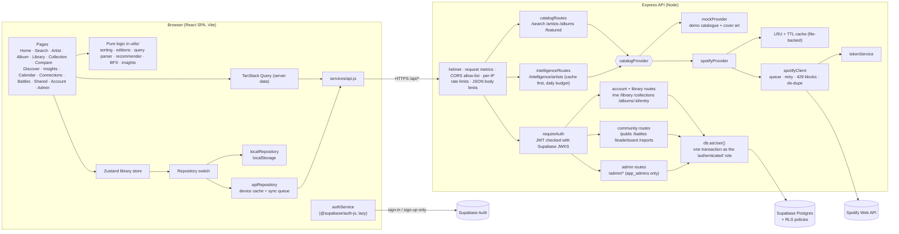

# Albumly architecture

Albumly is a React single-page app talking to an Express API.
- The API is the only part that knows about Spotify. It calls Spotify through one carefully rate-limited client, caches everything, and sends the browser small, already-cleaned-up JSON.
- A fictional **demo catalogue** can stand in for Spotify at any time.
- Accounts are optional. With Supabase configured, the API keeps each user's library in Postgres, protected by row-level security (RLS).

## The big picture

**Two rules decide where things live:**
1. **Data goes React → Express → Postgres.** The browser talks to Supabase directly only for signing in, because Supabase Auth is built for that.
2. **Spotify is reached only from the server.** The browser never sees Spotify's JSON or the client secret.

## Request lifecycle: opening an artist page

1. The browser visits `/artist/neon-harbor`. The `Artist` page is a **lazy chunk**, downloaded the first time it is needed.
2. `useArtist(id)` and `useDiscography(id)` check TanStack Query's memory cache (fresh for 5 minutes). On a miss they call `apiGet('/api/artists/neon-harbor')`.
3. Express runs, in order:
   - helmet (security headers)
   - request metrics (counted for the admin dashboard)
   - CORS
   - the per-IP rate limit (300 requests per 5 minutes)
   - then the route asks `getProvider()` for the configured catalogue.
4. **Mock:** the answer comes straight from `mockCatalog.js`.
5. **Spotify:** `cache.getOrLoad('artist:<id>', 1 day, load)`.
   - On a miss, `spotifyClient` waits for a free slot (at most 4 Spotify calls at once) and shares the call with any identical one in flight.
   - It adds a token that is renewed a minute early, and only once even when many requests need it.
   - It retries 5xx with backoff and jitter, honours short `Retry-After` waits, and remembers long blocks per endpoint, on disk.
6. `normalize.js` turns Spotify's JSON into Albumly's shapes (`Artist`, `Release`, `Track`).
7. Errors leave as one envelope, `{ error: { code, message, retryAfter? } }`. The client's `describeError` turns them into plain words.

The discography is the expensive call. Albums and singles are fetched in full; compilations and guest appearances send only page one until their tab is opened. Filtering, sorting, edition grouping, eras and the timeline all run in the browser on data already loaded.

## Request lifecycle: a signed-in change

1. The user rates an album. The library store calls `repository.save()`.
2. While signed in, the repository is `apiRepository`:
   - It writes the new state to a device cache straight away, so the UI never waits.
   - It works out the difference from the last state the server confirmed, as a queue of small, idempotent operations.
   - It sends `PUT /api/albums/:id/entry` with the session's access token.
3. Express `requireAuth` verifies the token locally against Supabase's public keys (issuer, audience, expiry). No call to Supabase is needed.
4. `db.asUser(userId, fn)` opens a transaction, switches to the `authenticated` role and sets the user id, so **RLS policies filter every query**. The SQL also says `where user_id = $1`; both checks must agree.
5. "Newest `updatedAt` wins" decides conflicts between devices. Another device picks the change up on its next pull (start, tab focus, back online).

## Client layers

| Layer | Responsibility | Examples |
| --- | --- | --- |
| Pages | Read URL state, compose components, set the page title | `pages/Artist.jsx`, `pages/Discover.jsx` |
| Components | Accessible widgets | `common/SearchBar.jsx` (ARIA combobox), `common/Tabs.jsx`, `library/ConfirmButton.jsx` |
| Hooks | Server data through TanStack Query; store selectors | `hooks/catalog.js`, `hooks/useLibraryProfile.js`, `hooks/useCommunity.js` |
| Services | The outside world | `services/api.js`, `services/session.js`, `services/library/*Repository.js`, `services/auth/authService.js` |
| Stores | App state with actions | `stores/libraryStore.js`, `stores/sessionStore.js` |
| Utils | Pure, framework-free, unit-tested logic | `utils/editions.js`, `utils/queryParser.js`, `utils/recommender.js`, `utils/artistGraph.js`, `utils/insights.js` |

**The URL is the state.** Explorer, library and search filters, the compared pair, calendar month and graph depth all live in the query string.

## Data model (Supabase Postgres)

Migrations: `database/migrations/0001`–`0004`. The ER diagram is in the README.
- **Library:** `profiles`, `library_entries` (the album snapshot as `jsonb`, tags as `text[]`), `collections`, `collection_albums`.
- **Community:** `collection_shares` (slug, visibility, moderation), `battles`, `battle_votes` (the primary key enforces one vote per user per battle), `reports`, `review_hides`, `app_admins`.

Every table has RLS on. Shared collections are read through a `security definer` function that returns only whitelisted fields, because RLS works per row, not per column.

## Code splitting

`router.jsx` loads every page except Home lazily.

| Chunk | Contains | When it loads |
| --- | --- | --- |
| entry + shared | React, router, TanStack Query, app shell, Home, library store (zod, zustand) | First visit |
| one per page | Search, Artist (+ eras), Album, Library, Collection (+ dnd-kit), Discover, Insights, Calendar, Connections, Battles, Account, Admin… | First visit to that page |
| `Compare`, `Insights`, `Admin` | Recharts | Only on those pages |
| auth | `@supabase/auth-js` | Only when accounts are configured |

The budget from PRD §3.3 (initial JS < 200 KB gzip) is checked by `npm run check:bundle`.

## Demo mode

`CATALOG_PROVIDER=mock` selects the demo catalogue: about 20 fictional artists with generated SVG covers, shaped exactly like the Spotify provider's output. It is used for:
- development without spending Spotify's small daily allowance (`npm run dev:demo`)
- unit tests and the Playwright suite
- the public demo whenever Spotify access is lost

The footer says "Demo mode" whenever `/api/health` reports `provider: mock`. It includes deliberate edge cases:
- same-name artists
- deluxe and remastered editions
- inferred EPs
- a two-disc album
- an artist with no image
- more guest appearances and compilations than fit on one page
- `!error` searches that simulate an outage

## Where the algorithms live (PRD §6.3)

| Algorithm | File |
| --- | --- |
| Debounce + request cancellation | `client/src/hooks/useDebounce.js`, TanStack Query `signal` |
| LRU (Map re-insertion) + TTL, request coalescing | `server/src/services/cache/lruCache.js` |
| Concurrency queue, backoff with jitter, per-endpoint blocks | `server/src/services/spotify/spotifyClient.js` |
| Single-flight token refresh | `server/src/services/spotify/tokenService.js` |
| Hash-map de-duplication across groups | `server/src/services/catalog/discographyService.js`, `client/src/utils/discography.js` |
| EP inference | `server/src/services/catalog/classify.js` |
| Levenshtein similarity, weighted edition score, union-find | `client/src/utils/editions.js` |
| Tokenizer + parser | `client/src/utils/queryParser.js` |
| Operation-queue sync, newest-wins merge | `client/src/services/library/sync.js`, `server/src/services/library/merge.js` |
| Cosine similarity, weighted scoring with explanations | `client/src/utils/vectors.js`, `recommender.js`, `preferences.js` |
| Breadth-first search with depth and node caps | `client/src/utils/artistGraph.js` |
| Group-by aggregation, eras, calendar | `client/src/utils/insights.js`, `eras.js`, `calendar.js` |
| Wilson score lower bound (leaderboard) | `server/src/services/community/ranking.js` |
| Space-Saving top-k (top searches) | `server/src/services/metrics/topSearches.js` |

## Testing layers

| Layer | Tool | Where |
| --- | --- | --- |
| Pure logic, services, components | Vitest (+ Testing Library, jsdom) | `*.test.js(x)` next to each file |
| Spotify behaviour without the network | `fakeSpotify.js` | `server/src/services/spotify/` |
| Database, RLS, routes without a cloud project | PGlite (real Postgres in WASM) | `server/src/db`, `server/src/routes/*.test.js` |
| The whole app in Chromium | Playwright, demo catalogue | `e2e/`, `npm run test:e2e` |
| Accounts end to end | Playwright + PGlite API + Supabase Auth answered by the test | `e2e/tests/accounts/` |
| Production build + CSP + headers | Playwright against `vite preview` with the `vercel.json` headers | `e2e/tests/prod/` |
| Performance, accessibility, SEO | Lighthouse + axe-core | `npm run test:lighthouse`, `e2e/tests/a11y.spec.js` |

## Hosting (prepared, not yet deployed)

Vercel serves the built client with security headers from `client/vercel.json`. Render runs the API from `render.yaml`. The browser calls the API cross-origin (`VITE_API_BASE_URL`, with `CLIENT_ORIGIN` as the CORS allow-list). Full steps: `docs/deployment.md`.
