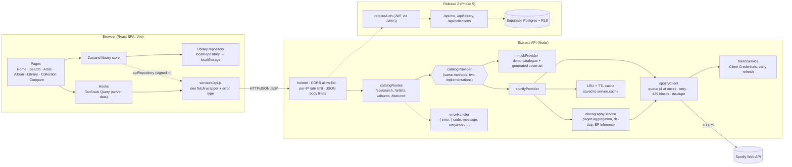

# Albumly architecture

_Draft for Phases 1–4 and the discography explorer. Accounts (Phase 5) are shown dashed; intelligence and community (Phases 6–7) get added in Phase 8 Part B._

Albumly is a React single-page app talking to an Express API. The API is the only part that knows about Spotify. It calls Spotify through one carefully rate-limited client, caches everything, and sends the browser small, already-cleaned-up JSON. A fictional **demo catalogue** can stand in for Spotify at any time.

## The big picture

## Request lifecycle: opening an artist page

1. The browser visits `/artist/neon-harbor`. The `Artist` page is a **lazy chunk**, downloaded the first time it is needed.
2. Two hooks run: `useArtist(id)` and `useDiscography(id)`. TanStack Query checks its in-memory cache first (fresh for 5 minutes). On a miss it calls `apiGet('/api/artists/neon-harbor')`.
3. Express runs helmet (security headers), CORS, and the per-IP rate limit (300 requests per 5 minutes). Then the route asks `getProvider()` for the configured catalogue.
4. **Mock:** the answer comes straight from `mockCatalog.js`.
5. **Spotify:** `cache.getOrLoad('artist:<id>', 1 day, load)`.
   - On a hit, nothing leaves the server.
   - On a miss, `spotifyClient.get('/artists/<id>')`:
     - waits for a free slot (at most 4 Spotify calls at once)
     - shares the call with any identical one already in flight
     - attaches a token from `tokenService`, which is renewed a minute before expiry and only once even when many requests need it
     - retries 5xx with backoff and jitter
     - honours short `Retry-After` waits
     - remembers long blocks per endpoint, on disk
6. `normalize.js` turns Spotify's JSON into Albumly's own shapes (`Artist`, `Release`, `Track`). The browser never sees raw Spotify data.
7. Any error is turned into the standard envelope by `errorHandler`. The client's `describeError` turns it into plain words, with a "Try again" button only when retrying can help.

The discography is the expensive call. `discographyService`:
- fetches albums and singles in full, but only page one of compilations and guest appearances
- stamps each release with its group
- removes duplicates with a hash map
- infers EPs
- returns a **completeness report**

The rest of a lazy group is fetched only when its tab is opened (`/api/artists/:id/discography/:group`). Filtering, sorting, edition grouping and the timeline all run in the browser on data already loaded: zero extra requests.

## Client layers

| Layer | Responsibility | Examples |
| --- | --- | --- |
| Pages | Read URL state, compose components, page title | `pages/Artist.jsx`, `pages/Library.jsx` |
| Components | Presentational, accessible widgets | `common/Tabs.jsx`, `common/SearchBar.jsx` (ARIA combobox), `library/ConfirmButton.jsx` |
| Hooks | Server data through TanStack Query; store selectors | `hooks/catalog.js`, `hooks/search.js`, `hooks/useLibrary.js` |
| Services | Talking to the outside world | `services/api.js`, `services/library/localRepository.js`, `services/recents.js` |
| Stores | App state with actions | `stores/libraryStore.js` (Zustand), `stores/compareStore.js` |
| Utils | Pure, framework-free, unit-tested logic | `utils/releases.js`, `utils/editions.js`, `utils/queryParser.js`, `utils/compare.js` |

**The URL is the state.** Explorer tab, filters, sort and view, plus library filters, search tab and filters, and the compared pair, all live in the query string. They survive reload and Back, and can be shared as a link.

**Library repository.** The store only knows `load / save / subscribe`. Phase 4 plugs in `localRepository` (versioned, zod-validated localStorage with salvage and a backup). Phase 5 swaps in `apiRepository` through a small switch, without changing any component.

## Code splitting

`router.jsx` loads every page except Home lazily.

| Chunk | Contains | When it loads |
| --- | --- | --- |
| entry + shared | React, router, TanStack Query, app shell, Home, library store (zod, zustand) | First visit |
| `Search`, `Artist`, `Album`, `Library`, `Collection` | One page each (Collection also has dnd-kit) | First visit to that page |
| `Compare` | Compare page + Recharts | Only when Compare is opened |

The budget from PRD §3.3 (initial JS < 200 KB gzip) is checked by `npm run check:bundle` after a build.

## Demo mode

`CATALOG_PROVIDER=mock` selects the demo catalogue. It is about 20 fictional artists with generated SVG covers (`/api/mock/art/:file`), shaped exactly like the Spotify provider's output. It is used for:
- **development** without spending Spotify's small daily allowance
- **tests**: unit tests, and the Playwright suite, which runs its own API on port 5066 that never reads `server/.env`
- **the public demo**, if Spotify access is lost (Premium lapses, or a 24-hour block)

The footer says "Demo mode" whenever `/api/health` reports `provider: mock`. The demo catalogue includes deliberate edge cases:
- same-name artists (Neon Harbor / Neon Harbour Tribute Band)
- a deluxe edition and a remaster
- inferred EPs
- a two-disc album
- an artist with no image
- more guest appearances (Cass Marlowe) and compilations (Driftwood Recordings) than fit on one page
- `!error` searches that simulate an upstream failure

## Where the algorithms live (PRD §6.3)

| Algorithm | File |
| --- | --- |
| Debounce + request cancellation | `client/src/hooks/useDebounce.js`, TanStack Query `signal` in `hooks/catalog.js` |
| LRU (Map re-insertion) + TTL, request coalescing | `server/src/services/cache/lruCache.js` |
| Concurrency queue, exponential backoff with jitter, per-endpoint blocks | `server/src/services/spotify/spotifyClient.js` |
| Single-flight token refresh | `server/src/services/spotify/tokenService.js` |
| Hash-map de-duplication across groups | `server/src/services/catalog/discographyService.js`, `client/src/utils/discography.js` |
| EP inference | `server/src/services/catalog/classify.js` |
| Levenshtein similarity, weighted edition score, union-find | `client/src/utils/editions.js` |
| Stable multi-key sort with partial dates | `client/src/utils/releases.js` |
| Tokenizer + parser | `client/src/utils/queryParser.js` |
| Schema migrations, salvage on load | `client/src/services/library/schema.js`, `localRepository.js` |

## Testing layers

| Layer | Tool | Where |
| --- | --- | --- |
| Pure logic, services, components | Vitest (+ Testing Library, jsdom) | `*.test.js(x)` next to each file in `client/` and `server/` |
| Spotify behaviour without the network | `fakeSpotify.js` stand-in for `fetch` | `server/src/services/spotify/` |
| Database and RLS without a cloud project | PGlite (real Postgres in WASM) | `server/src/db`, `server/src/routes/*.test.js` |
| Whole app in a real browser | Playwright (Chromium), demo catalogue | `e2e/`, `npm run test:e2e` |

## Hosting (prepared, not yet deployed)

Vercel serves the built client with security headers from `client/vercel.json`. Render runs the API from `render.yaml`. The browser calls the API cross-origin (`VITE_API_BASE_URL`, with `CLIENT_ORIGIN` as the CORS allow-list). Full steps: `docs/deployment.md`.
